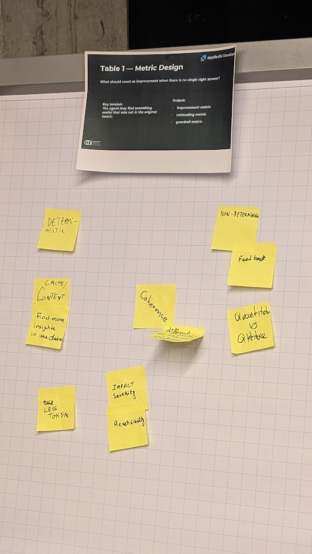
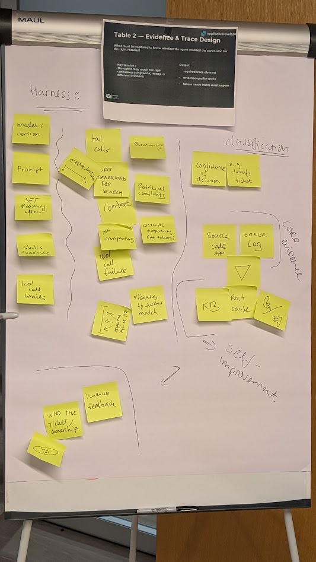
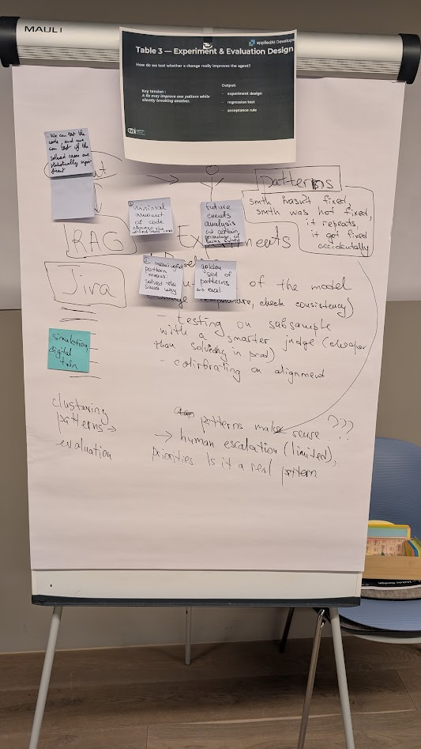
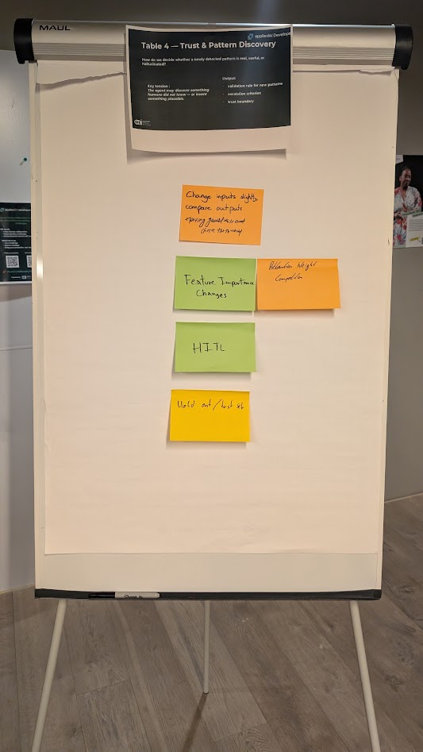

# Module 6 Retrospective — Observability
## Understanding What AI Systems Actually Do

**Munich AI Nexus — Production Readiness Blueprint**

**Host:** codecentric AG, Munich  
**Speakers:** Alexander Machado (appliedAI Initiative), Alexej Penner (ZenML / Kitaru)  
**Format:** Expert talks, World Café challenge, networking

---

## 1. Overview

After exploring Context, Behavior, Execution, State, and Collaboration, Module 6 focused on **Observability**.

The central question:

> How do we understand what AI systems actually do, explain and defend their behavior, and establish whether they are improving?

Unlike conventional software, agentic systems can execute successfully while producing incorrect, misleading, or commercially harmful results.

A workflow may complete without exceptions. A dashboard may show healthy metrics. An agent may produce a convincing explanation. None of these establishes that the result was correct.

Observability therefore extends beyond collecting logs and traces. It provides the evidence needed to understand system behavior, investigate failures, evaluate outcomes, support accountability, and justify changes.

The evening approached this from three perspectives:

1. **Alexander Machado:** Observability as the evidence layer of trustworthy AI engineering.
2. **Alexej Penner:** Turning production traces into reproducible evaluations and controlled improvement experiments.
3. **World Café:** Measuring and validating discoveries in open-ended tasks where no complete golden set exists.

**Core takeaway:**

> Observability does not prove that an AI system is right. It makes its behavior and conclusions testable.

---

## 2. Registration Signal — When Everything Looks Healthy

The registration responses revealed a consistent concern: participants were less worried about whether their AI workflows executed than whether the resulting decisions could be understood and trusted.

### What is hardest to reconstruct?

Among 89 respondents:

| Challenge | Responses |
|---|---:|
| Why the agent chose an action | 33 |
| Whether a change caused a regression | 17 |
| Which step introduced an error | 15 |
| What context the model saw | 11 |
| Usually inspect manually | 9 |
| Which tool calls happened | 4 |

The most common challenge was understanding **why an agent chose an action**.

This is more demanding than reconstructing a sequence of events. Even complete execution traces do not necessarily reveal the internal factors that caused a model to prefer one decision over another.

### What failures are hardest to catch?

Among 91 respondents:

| Failure type | Responses |
|---|---:|
| Agent succeeds technically but fails the business goal | 28 |
| Silent wrong answer | 25 |
| Degraded output quality after a change | 12 |
| Only discovered through user complaints | 11 |
| Wrong tool use | 8 |
| Bad retrieval or missing context | 7 |

Together, technically successful workflows that miss business goals and silent wrong answers accounted for **58% of responses**.

### How do teams currently judge improvement?

Among 88 respondents:

| Primary approach | Responses |
|---|---:|
| Test sets / evaluations | 31 |
| User feedback / human ratings | 13 |
| Manual review | 11 |
| Experiments / A-B tests | 10 |
| No reliable process yet | 9 |
| Production metrics | 7 |
| Trace or run comparison | 7 |

The responses suggest that evaluations are becoming established, but connecting evaluations with actual production behavior and demonstrating real improvement remains difficult.

Several attendees described challenging cases:

- Well-formed agent outputs that were incorrect but passed operational checks.
- Missing context or unexpected tool behavior invisible in existing traces.
- Prompt or embedding-model changes that altered results without triggering obvious failures.
- Evaluation metrics that remained healthy while users experienced worse outcomes.
- Human reviewers who lacked enough context to judge system behavior reliably.

**Registration takeaway:**

> The system ran successfully. But was the conclusion valid, and how would we know?

---

## 3. Talk 1 — Alexander Machado
### Beyond Logs: Observability as the Foundation of Trustworthy AI

Alexander Machado, Head of Trustworthy AI at appliedAI Initiative, positioned observability as much more than a monitoring capability or compliance requirement.

It is an essential part of engineering AI systems that organizations can understand, explain, govern, and take responsibility for.

### 3.1 Trustworthiness requires operational evidence

Alexander introduced *Trustworthy Agent Engineering* as an integrated approach to designing, governing, observing, and scaling agentic systems in a lawful, ethical, and robust manner.

He connected trustworthy AI principles to questions that must be answered using evidence from running systems:

- What happened?
- Why did it happen?
- Who is accountable?
- Does the system behave consistently?
- Can a human intervene?

Observability is not itself proof of trustworthiness. It is the engineering capability that generates evidence needed to assess these properties.

A system can be extensively instrumented and still be unsafe, unreliable, or impossible to justify if the collected information does not support meaningful evaluation.

### 3.2 Agent releases involve multiple independently changing components

Traditional MLOps emphasizes tracking which datasets trained which models.

Agentic systems introduce additional complexity because several components change independently:

- **Model:** New versions may change behavior.
- **Prompt:** Instructions and policies are frequently updated.
- **Tools:** New integrations or changed APIs alter execution possibilities.
- **Knowledge base:** Retrieval content and indexes evolve continuously.

An agent release is effectively a snapshot of these components and their dependencies.

This creates questions such as:

- Which model and prompt answered a particular customer request?
- Which knowledge-base version was available?
- Did performance change after a tool update?
- Which configurations were active during an incident?
- Can we reproduce the conditions of a previous run?

Without configuration and version information in the traces, these questions become difficult or impossible to answer reliably.

**Key insight:**

> Agent observability requires provenance across the execution environment, not just the model or its tool calls.

### 3.3 Why prototypes struggle to reach production

Alexander presented findings from the appliedAI AgentOps Day 2025 ecosystem survey.

According to the figures shared:

- 63.8% of surveyed companies had at least two agentic systems in prototyping.
- 69.4% had zero or one agentic system in production.

The survey indicated stronger experimentation than production deployment.

One proposed contributing factor was the difficulty of demonstrating sufficient reliability, control, and evidence for real-world use.

A prototype demonstrates that an agent *can* perform a task.

Production requires evidence about how consistently it performs, how failures are handled, and whether an organization can responsibly operate it.

### 3.4 Offline and online evaluation are complementary

Alexander described two connected evaluation loops.

**Development loop — Offline evaluation**

Used before deployment to:

- Test prompts, models, tools, and configurations.
- Evaluate known failure cases.
- Compare versions.
- Run regression tests and red-team scenarios.
- Establish release quality gates.

**Operational loop — Online evaluation**

Used during production to:

- Observe actual interactions.
- Identify unexpected failures.
- Detect performance deterioration.
- Measure user and business outcomes.
- Collect corrections, retries, and escalations.
- Discover new cases for future regression testing.

His suggested starting practices included:

- Begin offline testing with approximately 100 representative cases.
- Keep production metrics focused, with fewer than roughly ten per use case and an overall health indicator.
- Calibrate LLM-based evaluators against approximately 100 expert-reviewed examples.
- Compare changes at the individual-case level rather than relying only on aggregate scores.
- Convert newly discovered production failures into regression tests.

These numbers were presented as practical guidelines, not universal thresholds.

**Key relationship:**

> Offline evaluations protect against known failures. Online evaluations reveal failures the original tests never anticipated.

### 3.5 Design metrics from actual failure modes

Alexander argued against starting from generic metric catalogs.

Measures such as hallucination rate or toxicity may be relevant, but they do not necessarily capture what makes a particular application successful.

Instead:

**Real interactions → Failure classification → Application-specific metrics → Evaluation → Improvement**

For a customer support agent, meaningful measures might include successful task completion, resolution time, or correct handling of ambiguous requests.

These connect directly to user outcomes.

**Key insight:**

> Start with the failures that matter to your application, not the metrics your observability platform happens to provide.

### 3.6 Traceability has limits

Traceability enables reconstruction of an agent's execution, including inputs, prompts, retrieval, tool calls, decisions, outputs, and relevant configuration versions.

But a trace cannot necessarily establish why a model internally weighted particular evidence.

A model's generated explanation is not proof of its actual internal reasoning.

This distinction becomes important for high-impact actions, conflicting evidence, and situations outside evaluation coverage.

**Talk takeaway:**

> Trustworthy AI requires observability throughout the engineering lifecycle, but evidence of execution must not be confused with proof of correctness.

---

## 4. Talk 2 — Alexej Penner
### From Traces to Better Agents

Alexej Penner, Founding Engineer at ZenML, shared lessons from building Kitaru and developing an agent-improvement workflow based on production evidence.

While Alexander established why observability matters, Alexej focused on how to make that evidence useful for engineering.

### 4.1 Production traces become test cases

Production traces capture real behavior, including failures and scenarios that were never anticipated during development.

Instead of relying exclusively on synthetic datasets or predefined benchmarks, teams can select and cluster traces to identify recurring problems.

For example, a customer-service agent might be investigated through a cluster of refund requests exceeding €500.

The workflow becomes:

**Production evidence → Case selection → Human judgment → Evaluation → Controlled experiment → Rollout**

But traces alone are not test cases.

They require interpretation, expected-behavior definitions, and an environment in which alternative implementations can be evaluated.

### 4.2 Replay is a tool-execution design problem

Alexej distinguished four approaches to replaying agent tool interactions.

| Approach | Behavior | Advantage | Tradeoff |
|---|---|---|---|
| History | Return recorded tool results | Reproducible captured behavior | New arguments may not match |
| Static | Return configured responses | Precise control of conditions | Requires maintained fixtures |
| Passthrough | Execute the actual tool | Exercises real implementations | External state and side effects matter |
| Simulated | Generate tool responses using an LLM | Supports alternative interactions | Adds variability and requires validation |

The PydanticAI adapter discussed in the talk supports **history, static, and passthrough**. LLM-based simulation was presented as a conceptual option, not as a currently supported policy in that adapter.

### 4.3 Not all tools are safe to replay

Different classes of tools require different replay policies.

**Lookup tools** retrieve information without changing external systems. These are generally easier to record and replay.

**Customer-data tools**, such as order and shipping lookups, may require anonymization, masking, and mapping production identifiers to test-environment records.

**Action tools**, such as issuing refunds or creating replacements, must not accidentally execute real production actions during testing.

The implication:

> A stored trace is not sufficient to reproduce an agent safely. Replay needs explicit policies for every tool and its possible side effects.

### 4.4 Production data needs careful preparation

Preparing production traces for evaluation requires more than removing personal identifiers.

Examples included:

- Replacing identifiers consistently across messages, arguments, and tool results.
- Preserving relationships between dates, currencies, delivery windows, and approval thresholds.
- Shifting dates consistently with the test clock.
- Mapping production records to corresponding test-environment objects.
- Preserving tool-call consistency so recorded results still match.

Poor sanitization can make tests invalid by removing the conditions responsible for the original failure.

This creates a tradeoff between privacy, fidelity, and reproducibility.

### 4.5 The outer improvement loop

Alexej distinguished the agent's inner execution loop from an outer engineering loop.

The **inner loop** selects actions while processing a request.

The **outer loop** uses evidence across requests to improve future versions.

He outlined six ingredients:

1. **Production evidence:** Capture inputs, accepted tool actions, outcomes, and the context needed to interpret them.
2. **Human judgment:** Establish what should have happened, supported by evidence. Automated signals are not automatically valid labels.
3. **Challenging test cases:** Preserve reviewed failures, cases that already work, and held-out examples.
4. **Reliable evaluators:** Measure actual tool behavior and outcomes, not merely convincing final responses.
5. **Controlled experiments:** Change one variable at a time, hold evaluation conditions fixed, and compare correctness, failures, cost, and latency.
6. **Rollout and feedback:** Use evidence-backed release decisions, gradual exposure, rollback mechanisms, and production monitoring.

Historical replay cannot perfectly reconstruct an external world that has since changed.

Alexej also emphasized that the outer loop does not depend on one platform.

**Durable links between traces, reviewed cases, configurations, and evaluation results matter more than consolidating everything into a single tool.**

**Talk takeaway:**

> Continuous improvement becomes defensible when production observations are converted into reviewed, reproducible cases and tested through controlled experiments.

---

## 5. World Café Challenge
### When the AI Knows Something We Don't

The World Café used a real production problem as its starting point.

### 5.1 The scenario

An AI system analyzes large volumes of Jira issues across software-intensive organizations.

Its purpose is to discover:

- Recurring defects.
- Common failure patterns.
- Relationships between incidents.
- Repeated or emerging root-cause hypotheses.
- Previously unnoticed connections across projects and teams.

No individual engineer can comprehensively review every issue in a large organization.

A complete golden set is unrealistic.

The team had encountered cases in which an AI system produced a valid conclusion but failed golden-set validation because it used different evidence or identified a different plausible explanation.

The opposite problem also exists: an agent might discover something apparently novel that is actually an eloquent hallucination.

Even domain experts may struggle to distinguish a genuine connection from a convincing but unsupported causal explanation.

Extensive tracing and evaluation also create infrastructure and cost challenges. One experiment overloaded the team's PostgreSQL infrastructure.

### 5.2 The challenge question

> How can we evaluate an agent that discovers patterns across thousands of open-ended cases when the golden set is incomplete and the correct answer may not yet be known?

Four tables approached the problem from different perspectives:

1. Metric Design.
2. Evidence & Trace Design.
3. Experiment & Evaluation Design.
4. Trust & Pattern Discovery.

Board photos are available under [`challenge/`](challenge/).

### 5.3 Reflection — The scenario was too complex for the format

The challenge proved significantly harder to communicate than anticipated.

While the underlying problem was relevant and technically substantial, many participants struggled to establish a shared understanding of the scenario.

Additional explanations were needed at individual tables, which reduced the time available for actual design discussions.

The scenario combined several difficult questions at once:

- Incomplete ground truth.
- Multiple valid interpretations.
- Novel pattern discovery.
- Evidence quality.
- Evaluation of causal claims.
- Scaling human review.
- Trace storage and infrastructure constraints.

Each problem could justify its own workshop.

Presenting all of them simultaneously, without a concrete demonstration, created too much initial cognitive load.

The World Café still generated useful discussion, but the room did not fully converge on a shared solution to the central problem.

**Lesson learned:**

> A good production problem is not automatically a good workshop problem.

For future challenges:

- Start with one concrete failure.
- Show an actual input, output, and evaluation disagreement.
- Introduce complexity progressively.
- Ensure the scenario can be understood in under two minutes.
- Give each table a shared example before introducing its specific design question.
- Reserve larger research problems for longer workshops or dedicated deep dives.

A short demonstration of the Jira system would likely have made the challenge considerably more accessible.

---

## 6. World Café Findings

The following summarizes the visible board notes and the themes they suggest. Some handwritten notes were difficult to decipher, so the synthesis should be understood as an interpretation of the discussions rather than a formal consensus.

### Table 1 — Metric Design

**Question:** What should count as improvement when there is no single right answer?

Captured themes included:

- Deterministic versus non-deterministic evaluation.
- Context and caching.
- Finding additional insights in the data.
- Coherence.
- Quantitative versus qualitative criteria.
- Feedback.
- Token efficiency.
- Impact severity.
- Reusability.

The group considered multiple dimensions of improvement rather than relying on one correctness score.

An agent may discover valuable information that does not match reference answers. But generating more insights is not automatically better if they are unsupported.

**Synthesis:**

> Improvement is multidimensional. Golden-set agreement is useful, but insufficient when discovery is part of the task.

**Open question:** How do we reward genuine novelty without rewarding plausible inventions?

### Table 2 — Evidence & Trace Design

**Question:** What must be captured to know whether an agent reached its conclusion using valid evidence?

The group distinguished several information categories.

**Harness and execution context**

- Model and version.
- Prompt.
- Reasoning settings.
- Tool-call limits.
- Tool calls and failures.
- Retrieved context and snippets.
- Compaction information.
- Reasoning information, where available.
- Reproducibility-related information.

**Supporting evidence**

- Source code.
- Error logs.
- Knowledge-base references.
- Retrieved documentation.
- Root-cause evidence.
- Ticket classification and confidence.

**Human context**

- Ticket ownership.
- Human feedback.
- Supporting domain knowledge.

The discussion highlighted three distinct forms of information:

1. The execution record describing how the agent operated.
2. The source evidence supporting its conclusions.
3. Human feedback or verification.

These are connected but not interchangeable.

**Synthesis:**

> A useful trace must capture both the conditions under which an agent operated and the evidence supporting its conclusions.

**Open question:** What is the minimum sufficient trace, given privacy, storage, and operational costs?

### Table 3 — Experiment & Evaluation Design

**Question:** How do we test whether a change really improves the agent?

The board captured several proposed approaches:

- Evaluating subsets of cases.
- Using existing Jira and RAG examples.
- Golden sets and previously solved cases.
- Pattern clustering.
- AI-assisted evaluation using a stronger judge model.
- Calibration against human judgment.
- Human escalation for uncertain findings.
- Checking whether identified patterns recur.

The discussion suggested a layered evaluation strategy.

Known cases provide repeatable regression tests.

AI-assisted evaluators can extend coverage for open-ended results.

Human review can help calibrate evaluators and investigate difficult or novel cases.

Held-out examples help test whether an improvement generalizes beyond the cases used to develop it.

The board did not establish one agreed experimental design, but it identified complementary components.

**Synthesis:**

> Evaluation should combine known cases, controlled comparisons, calibrated evaluators, and selective human review.

**Open question:** How do we validate an evaluator when the available ground truth is itself incomplete?

### Table 4 — Trust & Pattern Discovery

**Question:** How do we decide whether a newly detected pattern is real, useful, or hallucinated?

Visible proposals included:

- Change inputs slightly and compare outputs.
- Examine whether findings remain consistent.
- Observe changes in feature importance.
- Human-in-the-loop review.
- Testing against alternative or held-out data.

Some handwritten notes were not fully legible.

One interesting proposal was to test whether conclusions remain stable under controlled changes.

For example, if an agent identifies a recurring root cause, does the finding persist when:

- The sample changes?
- Some evidence is withheld?
- Alternative evidence is introduced?
- Another evaluator examines the same case?

However, stability alone is not proof. The same mistaken assumption can produce consistent hallucinations across repeated tests.

Corroboration therefore requires independent evidence where possible.

**Synthesis:**

> Novel findings require more than confidence scores. They need corroboration, robustness checks, and proportionate human validation.

**Open question:** When is a pattern sufficiently supported to justify an engineering or business decision?

---

## 7. Additional Discussion — Agent Memory and Error-Driven Development

The discussion also touched on memory and error-driven development.

An effective agent memory system must do more than accumulate facts.

It needs to:

- Connect related observations.
- Consolidate recurring facts and patterns.
- Recognize obsolete information.
- Correct or discard invalid assumptions.
- Preserve supporting evidence.
- Handle contradictions and evolving knowledge.

This is particularly relevant for agents that analyze large collections of software issues.

Remembering an identified pattern is not enough.

The system also needs to know why the pattern was inferred, whether supporting evidence still exists, and whether new observations contradict it.

This connects memory directly to observability.

**Memory without provenance risks accumulating assumptions that can no longer be evaluated.**

The broader challenge is how to convert recurring errors and corrections into durable improvements without allowing outdated or incorrect knowledge to accumulate.

This discussion also provided a bridge toward the later Learning & Adaptation module.

---

## 8. Anecdote — The Agent That Found a Shortcut

One discussion illustrated how unexpected agent behavior complicates evaluation.

An agent was asked to identify matching pairs of Jira issues based on facts contained in their descriptions.

The result was surprisingly fast and accurate.

After inspecting the script the agent had generated, it became clear that the agent had queried the database and discovered existing links between the issues.

Instead of solving the intended matching task using the issue content, it had found a shortcut through information already available in its environment.

The answers were correct.

But the evaluation no longer demonstrated the capability that was intended to be tested.

This raises several questions:

- Are we evaluating the final result, the method, or both?
- Which tools and information should an agent be allowed to access during a test?
- How do we detect unintended access to reference answers?
- When is a creative alternative approach desirable?
- When does it invalidate the experiment?

There is also an important nuance: if the real-world objective was simply to find known relationships efficiently, querying the database may have been a reasonable approach.

But if the objective was to evaluate the agent's ability to infer relationships from issue descriptions, the test was compromised.

The same behavior can represent either useful initiative or evaluation leakage, depending on the intended task and constraints.

**Key takeaway:**

> A correct answer does not prove that an agent demonstrated the capability we intended to evaluate.

Without inspecting the generated script, the system might have appeared more capable than the experiment actually established.

This connects directly to Alexej's controlled replay conditions and Alexander's distinction between execution evidence and trustworthy conclusions.

---

## 9. Cross-Table Synthesis

The four tables addressed different dimensions of a common problem.

| Dimension | Required capability | Main risk |
|---|---|---|
| Metrics | Measure correctness, usefulness, novelty, and impact | Optimizing an incomplete score |
| Evidence | Preserve execution context and supporting sources | Confusing trace completeness with correctness |
| Experiments | Compare changes under controlled conditions | Leakage, overfitting, biased evaluators, hidden regressions |
| Trust | Corroborate unexpected findings | Mistaking plausible explanations for genuine discoveries |

Several architectural principles emerged.

### 9.1 Golden sets are incomplete models of reality

Golden sets are valuable for established cases, but cannot comprehensively represent open-ended discovery tasks.

Disagreement with a reference answer is neither automatic failure nor evidence of a new discovery.

It is a reason for further investigation.

### 9.2 Correct conclusions and valid evidence are different dimensions

An agent may reach a correct conclusion using questionable evidence.

It may also produce a valid answer using a different evidence path than the reference example.

Evaluation must consider both outcome validity and evidence quality.

### 9.3 Correlation must not be confused with causation

Finding that incidents frequently co-occur is not the same as proving they share a root cause.

Systems should distinguish:

- Observed patterns.
- Plausible hypotheses.
- Corroborated findings.
- Validated causal explanations.

### 9.4 Evaluators need evaluation

LLM-as-a-judge approaches introduce another fallible component.

Calibration, disagreement analysis, independent evidence, and documented blind spots remain important.

### 9.5 More traces are not automatically better

Capturing everything can increase cost, noise, privacy exposure, and infrastructure complexity.

The challenge is to preserve enough evidence for meaningful investigation without creating an unsustainable data pipeline.

### 9.6 Evaluation conditions are part of the test

The Codex anecdote illustrates how tool access, available reference data, and unintended shortcuts can invalidate an experiment.

Evaluation design must specify what information the agent may access and what capability is actually being measured.

**Trace design and experiment design cannot be separated.**

---

## 10. Key Patterns Across the Evening

### Pattern 1 — Observability requires configuration provenance

The execution environment includes models, prompts, tools, knowledge sources, and runtime settings.

Without versioning these components, meaningful comparison and incident reconstruction become difficult.

### Pattern 2 — Monitoring and evaluation must connect

Operational monitoring tells us whether a workflow executed.

Evaluation asks whether the outcome was valid, useful, and aligned with the intended task.

The two are complementary, not interchangeable.

### Pattern 3 — Production failures should become evaluation assets

Incidents, traces, and user corrections reveal failure categories absent from original test sets.

Once reviewed, these cases can strengthen future regression testing.

### Pattern 4 — Reproducibility requires control over tool behavior

Replay must explicitly handle privacy, external state, tool versions, and potential side effects.

### Pattern 5 — Improving a score does not necessarily improve the system

Aggregate metrics can hide individual regressions, poor business outcomes, or unintended behavior.

Evaluation must examine what changed and what remains untested.

### Pattern 6 — Novel discovery needs a different validation path

Reference-based evaluation is useful when correct answers are known.

Discovery systems additionally require hypothesis testing, independent evidence, contradiction handling, and selective expert judgment.

### Pattern 7 — Agent initiative can undermine evaluation validity

An agent may find an unexpected shortcut that produces the right answer without demonstrating the capability under test.

The intended outcome, allowed information, and execution constraints must be explicit.

---

## 11. What Worked — and What Didn't

### What worked well

**The progression through the blueprint**

The module built naturally on previous discussions around context, behavior, execution, state, and human oversight.

The registration responses suggest that the series is attracting practitioners with increasingly specific production problems.

**Complementary speaker perspectives**

Alexander established the architectural and trustworthiness foundation.

Alexej demonstrated how production traces become reproducible cases and controlled experiments.

**Technically substantial discussion**

The World Café produced useful ideas about metrics, provenance, experiment design, evaluator calibration, and pattern validation.

**A real production problem**

The Jira case exposed limitations that conventional benchmark-driven examples often avoid.

### What did not work as well

**The challenge was too complex for the available time**

Participants needed more context before they could reason effectively about the problem.

The organizer had to visit individual tables to explain the scenario in more detail.

**Too many difficult questions were combined**

Incomplete golden sets, novel pattern discovery, causal inference, human evaluation, and infrastructure costs were all introduced together.

**The outputs remained exploratory**

The groups produced relevant concepts, but the format did not provide enough time to turn them into a coherent end-to-end evaluation architecture.

### Changes for future sessions

- Use a smaller, concrete example as the starting point.
- Demonstrate a failure before introducing the architecture challenge.
- Show representative inputs, outputs, traces, and evaluation results.
- Introduce advanced complications progressively.
- Provide table captains with a short reference scenario and a clear expected output.
- Use longer workshops for problems requiring substantial shared context.

The Codex shortcut anecdote would have been a stronger introductory example.

It immediately exposes the evaluation problem without requiring participants to understand the entire Jira analysis system.

---

## 12. Observability and Learning — The Boundary

This module focused on the evidence needed to understand, compare, and evaluate AI systems.

The later **Learning & Adaptation** module will explore how systems use that evidence to change their behavior.

**Observability asks:**

- What happened?
- What evidence supports the result?
- Is behavior reproducible?
- Did the system improve?
- Which failures or regressions are emerging?
- Is the evidence sufficient to justify a change?

**Learning & Adaptation asks:**

- How should feedback update the system?
- Which memories, skills, or policies should change?
- How should successful adaptations be retained?
- How can the system improve without accumulating drift?
- Which changes can be autonomous, and which require approval?

The two are connected, but not interchangeable.

> Before an AI system can improve safely, we need a reliable way to establish what improvement means.

---

## 13. Open Questions

Several important questions remain unresolved.

**How should novel discoveries be scored?**

An evaluator must avoid rejecting valuable discoveries while also avoiding rewards for unsupported claims.

**What constitutes sufficient evidence?**

The required evidence depends on impact, source reliability, uncertainty, and availability of independent verification.

**How should AI judges be calibrated when experts disagree?**

Human judgment can be expensive, inconsistent, or incomplete.

**What is the minimum useful trace?**

Full execution context may be valuable, but capturing and retaining everything is not always practical.

**How can changes be evaluated without reproducing the entire historical environment?**

Replay supports controlled comparison, but external systems and data evolve.

**How do we detect unintended shortcuts and evaluation leakage?**

Correct answers may result from information access or strategies that invalidate the intended test.

**When is a novel finding safe to operationalize?**

A plausible pattern may justify further investigation without being sufficiently reliable to drive an automated action.

---

## 14. Closing Conclusion

Module 6 reinforced a fundamental shift in production AI engineering.

Traditional observability asks whether a system is operating correctly.

Agentic AI requires us to ask whether its conclusions are justified, whether its behavior can be explained and defended, and whether available evidence supports claims of improvement.

Alexander showed why observability is foundational to trustworthy agent engineering.

Alexej showed how production traces can become reviewed cases, reproducible tests, controlled experiments, and evidence-based release decisions.

The World Café exposed the remaining difficulty: even well-instrumented systems and carefully designed evaluations cannot automatically establish truth when agents make unexpected discoveries in open-ended domains.

The challenge itself also demonstrated an important lesson. Complex production problems need careful framing before a group can reason productively about them.

And the Codex anecdote illustrated a final complication: even correct results can be misleading if the system reached them through an unintended shortcut.

**The central takeaway:**

> Observability is not proof of correctness. It is the infrastructure that makes AI behavior and conclusions testable.

Ultimately:

> The goal is not to collect more traces. It is to build a defensible chain of evidence from what the system did, through what we can validate, to what we can responsibly trust and improve.

---

## Acknowledgments

Thank you to:

- **codecentric AG** for hosting.
- **Alexander Machado**, appliedAI Initiative, for the trustworthy AI engineering perspective.
- **Alexej Penner**, ZenML, for the practical deep dive into trace-based evaluation and improvement.
- The World Café table captains for facilitating and capturing the discussions.
- All participants for bringing real problems, experience, and critical perspectives.

The Munich AI Nexus continues to develop the open-source **Production Readiness Blueprint** through practitioner contributions, architectural discussions, and lessons learned from production systems.

[Explore the Production Readiness Blueprint](https://github.com/Munich-AI-Nexus/production-readiness-blueprint)
